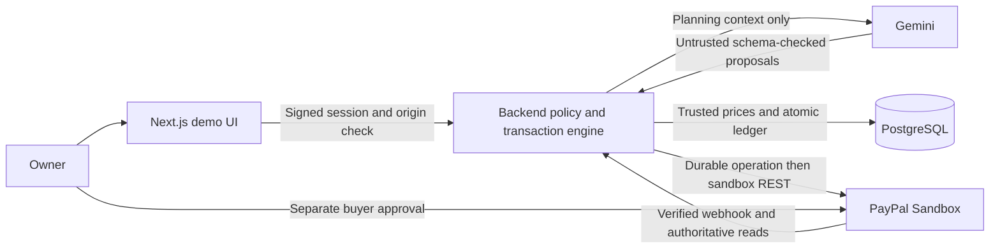
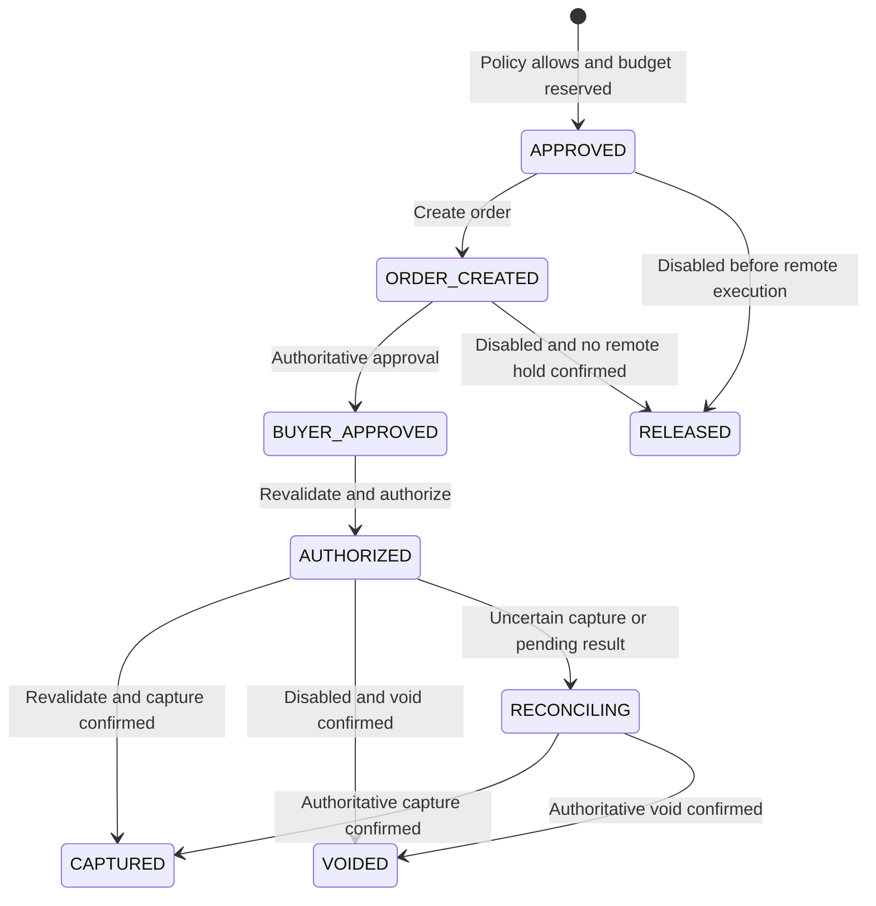

# Mandate — run the current prototype

“An AI agent can propose a purchase. Your rules decide whether money moves.”

## Current evidence

The Next.js interface, Gemini adapter, signed demo sessions, deterministic policy engine, atomic PostgreSQL ledger, audit trail and five scenario controls are implemented. Real ledger-backed buyer approval → authorization → capture is verified for USD 5.00. Real transaction webhook signatures and duplicate execution are verified. See LIVE-VERIFICATION.md and evidence/live-ledger.json.

Real authorize → revoke → blocked capture → void and live Gemini policy/proposal/explanation are verified locally. The app is deployed at https://mandate-paypal-ai.vercel.app on Vercel Hobby with dedicated Neon Free PostgreSQL. Hosted HTTP, Gemini, callback and access-control checks pass; a new payment and signed transaction webhook on the final host remain unverified. See HOSTED-VERIFICATION.md. No simulated payment success is used.

## 60-second walkthrough

Judge entry: open https://mandate-paypal-ai.vercel.app and choose either seeded demo owner; no signup is required. Draft with Gemini or review the labeled Guided seed, activate, then evaluate proposals. Evaluation and the split-spending scenario create no PayPal payment. The captured-payment and void reports contain prior real evidence. Payment judging requires a separately approved sandbox checkout and the purpose-created personal buyer login supplied privately by the owner; never publish its password.

1. Run npm ci, then npm run dev from this Mandate directory with Node 24 LTS. Open http://127.0.0.1:3000.
2. Choose Northstar Studio or Atlas Workshop. Review the seeded guided draft: $60 per fixed period, $40 per order, approved merchant/categories, no subscriptions, review above $30. Activate only after reviewing.
3. Select Guided to propose without model quota, or Live Gemini for actual provider calls. Select/evaluate products. Forbidden proposals are blocked before payment calls.
4. Approve a compliant basket. Budget becomes reserved before a real PayPal sandbox order exists. Open standard sandbox buyer approval using the purpose-created personal account.
5. Return and choose Verify buyer approval & complete. The backend revalidates, authorizes, revalidates separately and captures. Browser return alone never establishes success.
6. Inspect budget, operation IDs, ledger, real webhook IDs and audit trail. Use the scenario launcher. Fresh demo sessions preserve every previous transaction and unresolved reservation.

## Local setup

All real provider values belong in the ignored .env. .env.example contains placeholders. Never paste keys into chat, publish secrets or copy another project's credentials.

Required for local payment: PAYPAL_CLIENT_ID, PAYPAL_CLIENT_SECRET and PAYPAL_MERCHANT_ID from the same purpose-created sandbox business app. The buyer uses a separate personal sandbox account and enters its password directly on PayPal. No buyer password is stored by Mandate. US sandbox fixtures were configured for this USD demo; real account country details are never modified.

npm run dev starts real native PostgreSQL on loopback port 55440, migrates/seeds, and starts Next.js at port 3000. Its local database password and session secret are generated into ignored work/dev-config.json. Data persists under work/dev-postgres. No Docker is required or used. Keep the dev server running; Ctrl+C stops its database without deleting data.

For local background reconciliation in a second terminal:

```powershell
node --import tsx scripts/local-worker.ts
```

The worker performs bounded 20-second sweeps and retains ambiguous outcomes. Expired leases never authorize a retry of a possibly successful mutation. A continuously running deployed scheduler remains to be configured.

## Gemini

Set GEMINI_API_KEY privately. Default verified model: gemini-3.5-flash-lite. Real policy drafting, catalog proposal and grounded explanation passed through HTTP and native PostgreSQL, then in the browser. Evidence is in evidence/live-ai.json and evidence/live-ai-browser.txt. Historical3.1high-demand503 and other provider failures remain recorded. An oversized model proposal was blocked by the backend; model output never grants payment authority. Override GEMINI_MODEL only with a currently supported model and matching thinking setting.

The adapter uses strict schemas, 4,000-character input limits, bounded 2,500 output tokens, 45-second request timeouts, at most one 503/504 retry, twelve attempts per session and one hundred globally per day. Guided Replay is explicit and never simulates a payment.

## Webhooks and callbacks

The stable hosted sandbox webhook and registration are in evidence/webhook-registration-hosted.json. Earlier local tunnel evidence remains in evidence/webhook-registration.json. The tunnel was only for local verification and is not the final host.

Register a new stable URL with:

```powershell
node --import tsx scripts/register-webhook.ts https://YOUR-HOST/api/paypal/webhook --hosted
```

The hosted option preserves local environment configuration and writes separate redacted registration evidence. Store the returned PAYPAL_WEBHOOK_ID only in the target server environment. The script reuses an existing matching registration. Real events are verified with PayPal's postback mechanism; only SUCCESS enters the trusted inbox. Registration and unsigned-event rejection do not establish a real signed transaction on the final host.

APP_URL controls return/cancel URLs and allowed write origin. Use the same hostname consistently (127.0.0.1 locally); cookies are scoped by hostname. New /paypal/return callbacks redirect to configured APP_URL and never trigger payment execution. The old standalone port 8765 was occupied; its verified replacement is npm run callback on port 8766. That legacy probe callback is distinct from the current Next.js application's callback.

## Tests

```powershell
npm run lint
npm run typecheck
npm test
npm run test:postgres
npm run build
# With the dev server running; creates test-only demo sessions, no PayPal calls:
node --import tsx scripts/http-smoke.ts
```

Real PostgreSQL integration tests use a separate native cluster and unique schemas; PayPal is mocked only in that automated suite. Preserve and distinguish these tests from real sandbox evidence. Docker Compose is provided as an optional unverified alternative; the owner explicitly approved native PostgreSQL instead. For an existing dedicated test database, set DATABASE_URL, run npm run db:migrate, then npm run test:integration. Migrations001–004 preserve historical records. Hosted migrations execute inside Vercel without copying its database credential locally. Never point test tools at a production or unrelated database.

## Architecture



Database transactions are short and never span PayPal network calls. The AI cannot activate policies or execute a payment operation.



The diagram shows main transitions. Any ambiguous mutation or mismatched remote data can enter RECONCILING; its reservation remains held until authoritative evidence justifies spending or release.

## Trust boundaries and limitations

The mandate is an application-level control, not a PayPal-native delegated wallet. Only the authenticated owner activates immutable policies and performs extra review. The AI receives no credentials and cannot activate policies, override backend blocks, or call payment tools. Prices, merchant IDs, categories and recurring facts come from the server catalog. Money uses integer USD cents.

Available budget is the fixed-period total minus confirmed spending and held reservations. Blocked proposals create no hold. Reservations become spent only after authoritative capture confirmation. Cancel/expiry does not imply remote cancellation; uncertain remote outcomes retain budget. Refunds do not replenish mandate budget. A remote capture already executing can race with revocation and must be recorded honestly.

Signed sessions are purpose-created seeded demo access, not production signup/authentication. Routes check session ownership and current session mandate, write origin, strict input and server usage limits. The audit trail is not claimed tamper-proof. The public deployment has dedicated PostgreSQL, stable webhook configuration and a daily fallback scheduler; prompt continuous reconciliation and final-host signed transaction evidence remain open. The public webhook verifies signatures; administrative reconciliation requires its server secret.

## Troubleshooting and delivery

- PayPal CANNOT_PAY_SELF: use the separate personal sandbox buyer, not the merchant login.
- No authoritative APPROVED status: do not authorize. A callback is insufficient.
- Application expiry: capture is blocked even if PayPal still accepts its approval URL. Reconcile/void as appropriate; do not extend permission silently.
- Unknown order/capture timeout: retain reservation, inspect operations and reconcile. Never delete state to replay payment.
- Invalid webhook signature: check environment/app/webhook ID. Temporary verification failure must retry; do not mark verified. Real signed events, not simulator postback, are the evidence.
- Gemini 503/504 or exhausted quota: use visibly labeled Guided Replay and retain actual failure status.
- Database port collision: stop only the verified Mandate-owned instance or choose a dedicated loopback port; never terminate unrelated services or wipe data.

See DEPLOYMENT.md for release instructions and judging maintenance, HOSTED-VERIFICATION.md for final-host evidence and gaps, DEMO-SCRIPT.md for the under-three-minute recording plan, HACKATHON-DESCRIPTION.md for submission text, and LICENSE for MIT terms. The application is hosted; the source repository remains private. No paid commitment was accepted.
